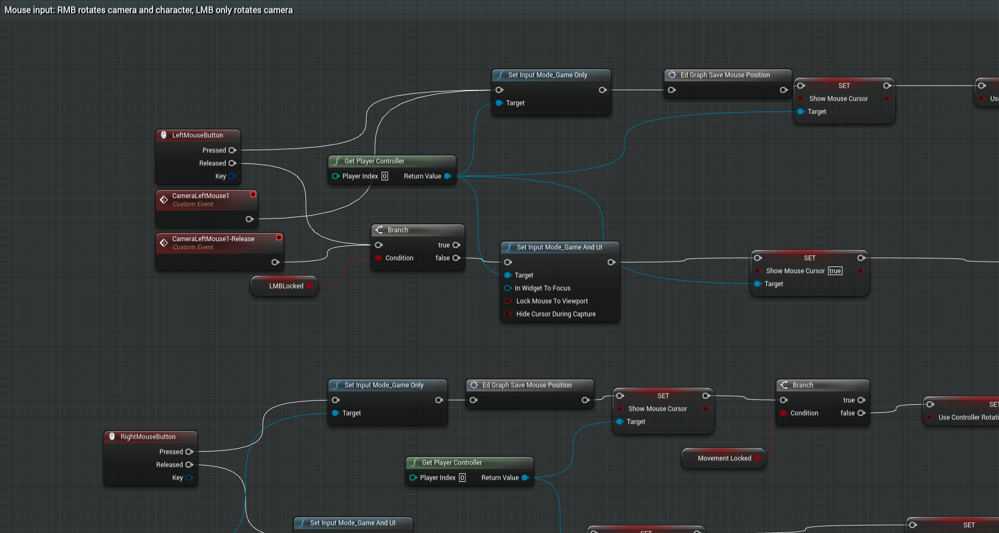

# BluePrintRenderer

> ## ⚠️ This project is no longer maintained
>
> **Superseded by [XenolithGraph](https://github.com/XenolithEngine/xenolith-graph)** — a
> modern TypeScript / WebGL re-imagining of this idea, with first-class typed Blueprint pins,
> in-node widgets, framework adapters (React / Vue / Svelte / Solid / Angular / Web Components),
> and a built-in MCP server so AI agents like Claude Desktop / Cursor can build graphs directly.
>
> - 🎮 **Live playground:** <https://xenolithengine.github.io/xenolith-graph/playground/>
> - 📦 **npm:** `npm install @xenolithengine/graph-editor pixi.js`
> - 📖 **Docs:** <https://xenolithengine.github.io/xenolith-graph/>
> - 🤖 **For AI agents:** <https://xenolithengine.github.io/xenolith-graph/agents.md>
>
> This repository is preserved for historical reference and is **read-only**. No further
> commits, issues, or PRs will be accepted here. Please open issues / questions against
> [XenolithGraph](https://github.com/XenolithEngine/xenolith-graph/issues) instead.

---

<!-- Original README content below — kept for historical reference -->

# Blue Print Renderer

Current features:

 * Blueprints rendering like UE4 Blueprint Editor

* Result:

* Online demo:
[Here](http://jsfiddle.net/strelok2012/2e918Ltg/4/embedded/result/)

### Based on:

 * [PIXI.js](https://github.com/pixijs/pixi.js)
